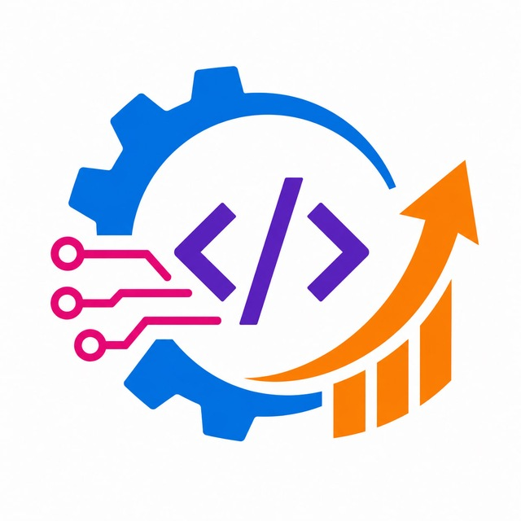
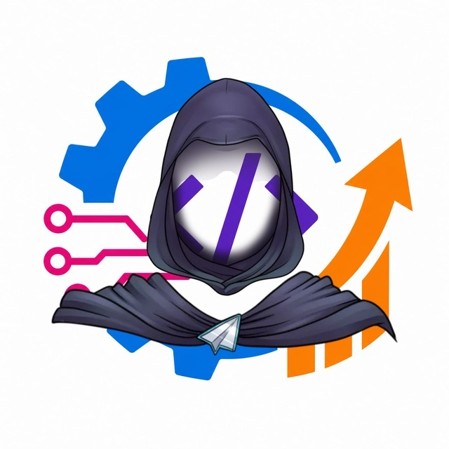
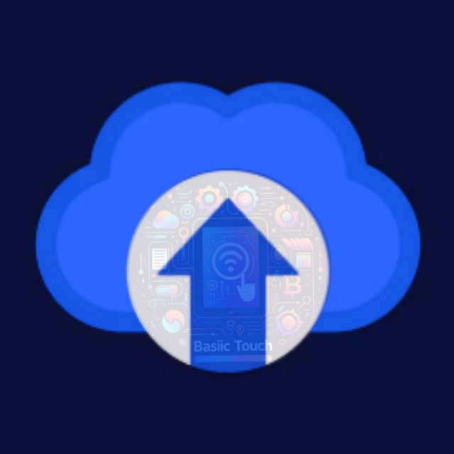
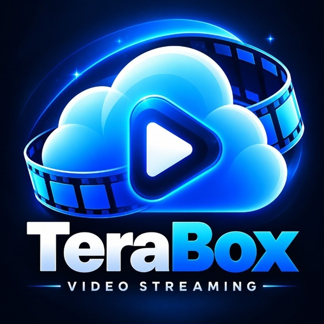

<!--
  Basic Touch Pro | Official GitHub Profile
  Repository: BasicTouchPro/BasicTouchPro
-->

  

  

<h1 align="center">Basic Touch Pro</h1>

<h3 align="center">
  Building Technology. Sharing Knowledge. Empowering the Next Generation.
</h3>

  A Developer & Technology Content Creator Focused on Innovation,
  Open Source, and Practical Digital Solutions.

  
  
  

  
  
  

---

## 👋 About Basic Touch Pro

**Basic Touch Pro (BTP)** is a technology-focused brand and content creation platform founded by **Md Al Azim**.

Our work combines software development, technology education, digital product development, and knowledge sharing. We explore ideas, build practical solutions, and create resources that can help people learn new skills and turn their ideas into reality.

Through our YouTube channel, we publish content about online earning opportunities, freelancing, digital marketing, online business strategies, passive income concepts, and useful technology-related topics.

Beyond content creation, software development is at the heart of what we do.

We build websites, web applications, Windows desktop software, Android applications, Telegram bots, automation tools, and other digital solutions.

This GitHub profile is our space to share selected source code, showcase projects, publish open-source software, and document our journey as developers and creators.

## 🎯 Our Mission

We believe technology should be a tool for learning, creativity, and positive change.

Our mission is to share useful source code, build meaningful open-source projects, and help the next generation of developers learn, create, and build a better future through technology.

We want our work to be useful not only today, but also for people who will discover these resources in the future.

### What We Believe In

- 📚 **Knowledge Sharing:** Making useful technical knowledge and learning resources accessible.
- 🌍 **Open Source:** Publishing selected projects that others can study, use, and improve under their respective licenses.
- 💡 **Innovation:** Encouraging developers to experiment, solve problems, and build new ideas.
- 🛠️ **Practical Development:** Creating software and tools that address real-world needs.
- 🤝 **Community:** Supporting collaboration, learning, and constructive feedback.
- 🚀 **Future Generations:** Helping aspiring developers build their skills and create meaningful projects.

Our long-term goal is to contribute to a community where knowledge is shared, ideas grow, and developers help one another move forward.

## 👨‍💻 Meet the Developer

Hi, I'm **Md Al Azim**, the creator behind Basic Touch Pro.

I enjoy building software, exploring new technologies, solving technical problems, and developing digital products.

My main areas of interest include web development, Windows desktop application development, and professional Telegram bot development. I also work on Android application projects and continue to expand my skills through practical development.

### What I Do

- **Web Development:** Websites, web applications, dashboards, backend systems, and APIs.
- **Windows Development:** Desktop applications, software utilities, and custom tools.
- **Android Development:** Mobile application projects and Android-based solutions.
- **Telegram Bot Development:** Utility bots, automation systems, integrations, and API-powered services.
- **Backend Engineering:** Server-side programming, database integration, and application logic.
- **Digital Product Development:** Building and maintaining online services and software tools.
- **Technology Content Creation:** Sharing educational content, tutorials, and practical knowledge with the community.

I believe that consistent learning, experimentation, and building real projects are essential to becoming a better developer.

## 🛠️ Technologies & Skills

These are some of the technologies and development areas I work with.

  
  
  
  
  
  
  

### Development Areas

- Web and backend development
- Database design and MySQL integration
- API development and integration
- Windows desktop application development
- Android application development
- Telegram bot development and automation
- Digital tools and online service development

Our tools and technologies may evolve as we work on new projects and explore new approaches.

---

## 🚀 Our Products & Digital Services

We develop and maintain digital products that serve different purposes, from payment-related services to Telegram-based tools.

The following products represent our current portfolio. Features, availability, and service links may change as projects evolve.

### 01. FastPay24

  

**Payment Gateway & Payment Verification**

FastPay24 is a digital payment-related platform focused on payment gateway functionality and payment verification solutions.

Visit the official website to explore the currently available services and features.

  

### 02. Free Tools Bot

  

**Free Telegram Utility Tools**

Free Tools Bot is a Telegram-based project designed to make useful utilities accessible through a convenient chat interface.

  

### 03. Image Uploader Bot

  

**Telegram Image Hosting Service**

Image Uploader Bot provides a Telegram-based interface for uploading images and accessing its associated image-hosting service.

  

### 04. TeraBox API Provider Bot

  

**TeraBox API-Related Telegram Service**

This project provides a Telegram-based interface for a TeraBox API-related service. Visit the bot to explore its current functionality and availability.

  

### 05. Link Shortener

  

**Link Management & Digital Marketing Tools**

Our link-shortening service focuses on creating shorter URLs and supporting link management for online publishing and digital marketing workflows.

  

> **Please note:** Product availability and functionality may change over time. Listing a product here does not mean that its source code is open source. Open-source status and usage permissions are determined by the license and documentation of each individual repository.

---

## 🌱 Open Source & Public Repositories

Our GitHub presence is intended to be more than a collection of code.

We want to build a growing library of useful projects and development resources that help other people learn, experiment, and create.

As we develop new software, we aim to publish selected projects publicly when appropriate and provide documentation that helps others understand their purpose and usage.

### Our Open-Source Goals

- Publish useful source code and reusable components.
- Share practical examples for developers and learners.
- Create tools that can be improved through community feedback.
- Document projects clearly whenever possible.
- Encourage responsible collaboration and knowledge sharing.
- Add new public projects as our work grows.

### How You Can Contribute

If a repository welcomes community contributions, you can:

- ⭐ Star the project to show your support.
- 🍴 Fork the repository to experiment with the code.
- 🐛 Report bugs and suggest improvements.
- 💬 Open discussions or issues where supported.
- 🤝 Submit pull requests that follow the project's guidelines.

Please check the README, license, and contribution instructions of each repository before using or modifying its code.

**Our commitment:** We want to make useful knowledge easier to access and help future developers build on what they learn.

## 📺 YouTube & Educational Content

Basic Touch Pro is also an educational content creation channel.

We publish content intended to help viewers explore digital opportunities, understand online platforms, and develop useful skills.

### Topics We Explore

- Online earning opportunities and strategies
- Freelancing tips and practical guidance
- Online business ideas
- Digital marketing and online promotion
- Passive income concepts
- Reviews of online platforms and services
- Technology tutorials and useful digital tools

We aim to provide informative content that helps people learn and make more informed decisions. Online earning opportunities vary, and no particular income or financial outcome is guaranteed.

  

## 🤝 Connect With Us

We welcome constructive feedback, project ideas, and opportunities to share knowledge.

  
  
  

| Platform | Link |
|---|---|
| YouTube | [Basic Touch Pro](https://www.youtube.com/@BasicTouchPro) |
| Telegram | [Basic Touch Pro Community](https://t.me/BasicTouchPro) |
| Official Website | [www.basictouch.pro](https://www.basictouch.pro/) |
| GitHub | [BasicTouchPro](https://github.com/BasicTouchPro) |

## 📊 GitHub Statistics

  
  

  

  <em>Statistics are provided by third-party services and may occasionally be unavailable. Language statistics represent detected repository code, not necessarily overall developer proficiency.</em>

---

## 💙 Building a Better Future Together

We believe every developer starts somewhere, every idea has the potential to grow, and every shared resource can help someone take the next step.

At Basic Touch Pro, we want to keep learning, building, documenting, and sharing. Through our software projects, educational content, and open-source contributions, we hope to make technology more approachable for the next generation.

Whether you are a beginner learning to code, a developer exploring new ideas, or someone looking for useful digital tools, we hope you find something valuable here.

**Learn. Build. Share. Inspire.**

  <strong>Basic Touch Pro</strong> 
  <em>Technology • Development • Creativity • Open Source</em>

  <a href="https://github.com/BasicTouchPro">
    Explore Our Repositories
  </a>
  &nbsp; • &nbsp;
  <a href="https://www.youtube.com/@BasicTouchPro">
    Watch Our Videos
  </a>
  &nbsp; • &nbsp;
  <a href="https://t.me/BasicTouchPro">
    Join Our Community
  </a>

